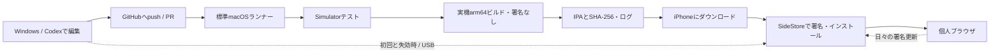

# 開発・実行アーキテクチャ

対象: iPhone 12、iOS 18.4.1。2026-10-22（日本時間）、ユーザーの選択により**新規SwiftUI＋WKWebView**を採用。初期実装のファイル構成と検証状況は[実装状況](implementation-status.ja.md)を参照。以下のFirefox案は比較時の代替案として残す。

## 開発とインストールの分離

GitHubはアプリのソースとビルド成果物を扱う。Apple Account、2FA、ペアリング情報はWindows・iPhone側で扱う。GitHub ActionsにAppleのパスワードや署名用秘密鍵を持たせない。更新されない週にビルドを回す必要はない。

## Firefoxを採用する場合

上流を大きく組み替えず、`Personal`構成・個人用schemeを追加する。最初の段階ではUIKit主体の上流設計を使う。

| 層 | 担当 | 変更方針 |
|---|---|---|
| Browser UI | ツールバー、アドレス欄、タブ一覧、メニュー | 上流のToolbar/Browser画面を変更。SwiftUIは局所導入 |
| 操作・設定 | ボタン配置、長押し、ジェスチャー、検索先 | 個人用設定型とコマンド一覧を追加し、UIから直接WebViewを操作する箇所の増殖を抑える |
| タブ・閲覧 | 既存TabManager / WebView / ナビゲーション | 既存動作を再利用。セッション復元と認証ポップアップを回帰試験 |
| 保存 | 履歴、ブックマーク、設定、WebKitデータ | App Group依存を本体のApplication Support等へ変更。移行と上書き更新を実機確認 |
| 外部サービス | Sync、実験、テレメトリー、クラッシュ送信 | 個人用構成で無効化。必要になった時に個別に再設計 |
| 配布 | 個人用本体1ターゲット | 拡張、Push、Siri、既定ブラウザ等の不要な権限を整理 |

最初の実装段階の合格条件は「ビルド成功」だけにしない。実機起動、ページ表示、再起動後の保存、SideStore更新後の保存までを含める。

無料署名用にentitlementsを空にするだけの一括パッチは採らない。権限とコード上の依存関係を対応づけ、保存先、Keychainアクセス、拡張との連携を変更する。OS標準の証明書評価を維持する。

フォークの構成は、上流の履歴を維持する`upstream`と個人開発用`main`、上流取り込み用`update/upstream-*`を想定する。個人用ビルド調整とUI機能は別のコミットにし、上流変更による競合を追いやすくする。上流の更新を自動マージしない。

## 採用した新規実装

SwiftUI、WKWebView、Foundationを中心に、本体1ターゲットとローカルSwift Packageで始める。WebKit非依存のURL入力解決、タブモデル、設定、保存フォーマットをCoreへ分け、Windows/WSLでも可能な部分をテストする。WKWebViewの所有者・delegateはMainActor上に集約する。

UIの再描画でWKWebViewを作り直したりreloadしたりしない。通常タブは永続Webデータストア、プライベートタブは一時ストア。プライベートURL・タイトルを通常履歴・復元ファイル・ログに保存しない。タブ上限と非アクティブタブの休止方針を持ち、iPhone 12でメモリを計測する。

最低限の第1版: URL/検索入力、戻る/進む/再読込/停止、複数タブ、ブックマーク、履歴、通常タブ復元、プライベートタブ、共有、ツールバー位置・ボタン配置設定。次段階: ダウンロード、ページ内検索、ポップアップ認証・ファイル選択の互換性、データのエクスポート/インポート。

## CI設計

Linuxのツール検査・Coreテストと、macOSテスト・IPA生成を実装した。非公開の`koyuuuuu/personal-browser`を使用し、無料枠内・超過時停止で開始する方針。現在はLinux・macOSとも手動起動だけに限定し、push/PRでは実行しない。課金停止設定の確認後、Linuxのpush/PRトリガーを追加して自動化する。macOSは引き続き手動実行とする。

1. push/PR: Linuxで生成済み設定・検査ツール・Coreの単体テストを実行する。
2. 手動: macOSでCoreテストとSimulatorでの短いUIスモークテストを通し、任意でRelease相当の実機arm64ビルドを署名なしで生成する。Webページのテストはローカルの固定HTMLを使い、ネットワーク障害による不安定さを避ける。
3. IPA化: `Payload/<product>.app`へコピーして圧縮。個人用構成で拡張をビルド・埋め込み対象から除外する。生成後に削除するだけでコード側の依存が消えるとは考えない。
4. 検査: `scripts/inspect_ipa.py --target-ios 18.4.1 --unsigned`。SHA-256、Bundle ID、バージョン、対象プラットフォームを記録。
5. 保存: IPAと失敗ログは1日保存。巨大なDerivedDataやxcresultをアップロードしない。公開Releaseへのアップロードは別途確認してから追加する。

`pull_request_target`で外部PRのコードを高権限実行しない。通常のワークフローは`contents: read`、同じブランチの古い実行はキャンセル、無限リトライや常時定期ビルドを置かない。

新規実装の標準macOSランナーは`macos-15`、Xcodeは初期値ではそのランナーの既定版を使用し、バージョンとSDK一覧をログに残す。Swift 6のCoreテストとiOS 17以上のアプリをビルドするため、Xcode 16以上が必要。必要ならRepository Variablesの`BROWSER_XCODE_PATH`で搭載済みのXcodeを選ぶ。iOS 18.4.1の実機互換性と、CIで利用可能なSimulatorのOSは別に管理する。

参考: [GitHub標準ランナー](https://docs.github.com/en/actions/reference/runners/github-hosted-runners)、[Xcode 27搭載ソフトウェア](https://github.com/actions/runner-images/blob/main/images/macos/xcode-27-arm64-Readme.md)。ランナーに存在しないバージョンを指定して待ち続ける設定はしない。

## Codexでの開発・修復

無料運用の初期案は、現在利用できるCodexの環境で編集・修正し、通常CIが失敗ログを返す構成。AIのCI内自動実行には利用枠やAPI料金等があるため、無料CIと一体で無制限に使えるとはしない。[公式Codex Action](https://github.com/openai/codex-action)の追加は認証・費用を確認してから行う。

Codexへの修正指示には、失敗したcommit、Xcode/SDK、ログ、再現手順、期待する結果を含める。まずWindowsで編集し、macOSでのみ確認できる内容はCIで検証する。修正のたびに無関係な全テストを回し続けず、該当テストと必須ビルドを実行する。

実機のDeveloper Mode、Apple認証、VPN許可、USB信頼、ロック状態、SideStoreの更新成功確認は人の操作が残る。CodexがクラウドからiPhoneを操作できるという設計にはしない。
