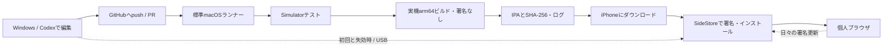

# 開発・実行アーキテクチャ

対象: iPhone 12、iOS 18.4.1。2026-10-22（日本時間）、ユーザーの選択により**新規SwiftUI＋WKWebView**を採用。初期実装のファイル構成と検証状況は[実装状況](implementation-status.ja.md)を参照。以下のFirefox案は比較時の代替案として残す。

## 開発とインストールの分離

GitHubはアプリのソースとビルド成果物を扱う。Apple Account、2FA、ペアリング情報はWindows・iPhone側で扱う。GitHub ActionsにAppleのパスワードや署名用秘密鍵を持たせない。更新されない週にビルドを回す必要はない。

## Firefoxを採用する場合

上流を大きく組み替えず、`Personal`構成・個人用schemeを追加する。最初の段階ではUIKit主体の上流設計を使う。

| 層 | 担当 | 変更方針 |
|---|---|---|
| Browser UI | ツールバー、アドレス欄、タブ一覧、メニュー | 上流のToolbar/Browser画面を変更。SwiftUIは局所導入 |
| 操作・設定 | ボタン配置、長押し、ジェスチャー、検索先 | 個人用設定型とコマンド一覧を追加し、UIから直接WebViewを操作する箇所の増殖を抑える |
| タブ・閲覧 | 既存TabManager / WebView / ナビゲーション | 既存動作を再利用。セッション復元と認証ポップアップを回帰試験 |
| 保存 | 履歴、ブックマーク、設定、WebKitデータ | App Group依存を本体のApplication Support等へ変更。移行と上書き更新を実機確認 |
| 外部サービス | Sync、実験、テレメトリー、クラッシュ送信 | 個人用構成で無効化。必要になった時に個別に再設計 |
| 配布 | 個人用本体1ターゲット | 拡張、Push、Siri、既定ブラウザ等の不要な権限を整理 |

最初の実装段階の合格条件は「ビルド成功」だけにしない。実機起動、ページ表示、再起動後の保存、SideStore更新後の保存までを含める。

無料署名用にentitlementsを空にするだけの一括パッチは採らない。権限とコード上の依存関係を対応づけ、保存先、Keychainアクセス、拡張との連携を変更する。OS標準の証明書評価を維持する。

フォークの構成は、上流の履歴を維持する`upstream`と個人開発用`main`、上流取り込み用`update/upstream-*`を想定する。個人用ビルド調整とUI機能は別のコミットにし、上流変更による競合を追いやすくする。上流の更新を自動マージしない。

## 採用した新規実装

SwiftUI、WKWebView、Foundationを中心に、本体1ターゲットとローカルSwift Packageで始める。WebKit非依存のURL入力解決、タブモデル、設定、保存フォーマットをCoreへ分け、Windows/WSLでも可能な部分をテストする。WKWebViewの所有者・delegateはMainActor上に集約する。

UIの再描画でWKWebViewを作り直したりreloadしたりしない。通常タブは永続Webデータストア、プライベートタブは一時ストア。プライベートURL・タイトルを通常履歴・復元ファイル・ログに保存しない。タブ上限と非アクティブタブの休止方針を持ち、iPhone 12でメモリを計測する。

最低限の第1版: URL/検索入力、戻る/進む/再読込/停止、複数タブ、ブックマーク、履歴、通常タブ復元、プライベートタブ、共有、ツールバー位置・ボタン配置設定。次段階: ダウンロード、ページ内検索、ポップアップ認証・ファイル選択の互換性、データのエクスポート/インポート。

## CI設計

非公開のkoyuuuuu/personal-browserで、mainへのアプリ・ビルド・配信コードのpushから検証と配信までを自動化する。文書のみの変更ではビルドしない。無料枠内・超過時停止を維持し、定期ビルドは設けない。

1. LinuxでPython検査と生成プロジェクトの整合性を検査。
2. macOSでCore 19件、Simulator UI 5件、v0.1.0と現在版の保存処理を別々にコンパイルしたデータ互換性検査を実行。UIは固定HTMLを使用する。
3. 実機arm64 Releaseを署名なしで生成し、固定Bundle ID、バージョン、最低OS、Mach-O、拡張混入、SHA-256を検査。
4. contents:writeを持つLinuxのpublishジョブが、非公開ReleaseにIPA・build-info.json・SHA256SUMS.txtを保存。タグは検証したソースSHAに固定。
5. 配布専用の公開リポジトリにIPA Releaseを公開し、全参照ファイルの検査後にSideStore source.jsonを更新。公開先のGitツリーにはREADME・JSON・アイコンだけを置き、本体のソースツリーはコピーしない。
6. iPhoneはSideStoreから既存アプリへ上書き更新する。7日間の署名Refreshとは別であり、新版のインストール操作はユーザーが行う。

通常ジョブはcontents:read、publishジョブだけcontents:write。別リポジトリ用トークンは公開先だけに限定し、非公開側のActions Secretsからpublishジョブへ渡す。pull_request_targetや外部PRからの公開処理は使わない。同一ブランチの実行は直列化し、配信途中のキャンセルを避ける。巨大なDerivedDataやxcresultは保存せず、一時成果物・失敗画面は1日保持する。詳細は[自動配信](distribution.ja.md)。

Simulatorは選択中のXcodeのSimulator SDK以下で、利用可能な最新のiPhoneを選ぶ。ランナーに新しいOSが同居していても、SDKより新しいRuntimeは選ばない。失敗時はログとUIテストの添付（スクリーンショットを含む）を1日保存する。Xcode 16.4 / iOS 18.5ではSwiftUI MenuのAXタップ位置が取得できなかったため、該当UIテストは画面内のボタン中央への実際のタッチを送り、メニュー表示後の操作結果まで検査する。

新規実装の標準macOSランナーは`macos-15`、Xcodeは初期値ではそのランナーの既定版を使用し、バージョンとSDK一覧をログに残す。Swift 6のCoreテストとiOS 17以上のアプリをビルドするため、Xcode 16以上が必要。必要ならRepository Variablesの`BROWSER_XCODE_PATH`で搭載済みのXcodeを選ぶ。iOS 18.4.1の実機互換性と、CIで利用可能なSimulatorのOSは別に管理する。

参考: [GitHub標準ランナー](https://docs.github.com/en/actions/reference/runners/github-hosted-runners)、[macOS 15搭載ソフトウェア](https://github.com/actions/runner-images/blob/main/images/macos/macos-15-arm64-Readme.md)。ランナーに存在しないバージョンを指定して待ち続ける設定はしない。

## Codexでの開発・修復

無料運用の初期案は、現在利用できるCodexの環境で編集・修正し、通常CIが失敗ログを返す構成。AIのCI内自動実行には利用枠やAPI料金等があるため、無料CIと一体で無制限に使えるとはしない。[公式Codex Action](https://github.com/openai/codex-action)の追加は認証・費用を確認してから行う。

Codexへの修正指示には、失敗したcommit、Xcode/SDK、ログ、再現手順、期待する結果を含める。まずWindowsで編集し、macOSでのみ確認できる内容はCIで検証する。修正のたびに無関係な全テストを回し続けず、該当テストと必須ビルドを実行する。

実機のDeveloper Mode、Apple認証、VPN許可、USB信頼、ロック状態、SideStoreの更新成功確認は人の操作が残る。CodexがクラウドからiPhoneを操作できるという設計にはしない。
